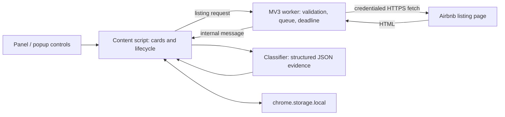

# StayCam Check


An experimental Chrome Manifest V3 extension that labels Airbnb search-result cards using structured exterior-camera disclosures returned by listing pages.

**Disclosure analysis, not physical camera detection.** Results can be wrong: negated wording and records belonging to another listing can be misinterpreted. Neither an unavailable amenity nor a missing entry establishes that a property has no cameras. Review the listing and ask the host; do not use these labels as a property-safety decision.

## What it does

- Manual scans from a floating panel or extension popup.
- Four disclosure classifications, with optional hiding of cards classified as `camera`.
- One request/result per unique listing ID during an ordinary scan, applied to accepted duplicate card representations.
- Sequential background requests with at least 900 ms between starts and a 20-second fetch/body deadline.
- Stop after the current check, Clear with stale-result invalidation, and deliberate restart.
- Local classification reuse for seven days; newest 500 entries retained on saves.
- Optional auto-scan for newly discovered results after a manual Scan activates it. Enabling the setting alone does not start a fresh-page scan.

The primary workflow is **destination-specific search results on English-language Airbnb pages**. Homepage carousels and every possible listing layout are not supported consistently.

## Reading the labels

These are the intended meanings of the four states for supported evidence, subject to the accuracy limits above:

| State | Current badge | Intended interpretation |
| --- | --- | --- |
| `camera` | Camera confirmed | An exterior camera is explicitly disclosed in recognized amenity or safety/policy evidence. |
| `no_camera` | Camera explicitly unavailable | The exterior-camera amenity is explicitly unavailable in supported evidence. |
| `not_listed` | Camera amenity not listed | No exterior-camera entry was found in a sufficiently complete supported amenities inventory. |
| `unverified` | Could not verify | Evidence is insufficient, conflicting, inaccessible, unsupported, or otherwise inconclusive. |

The current **Camera confirmed** badge is a classifier outcome, not independently verified fact. The extension cannot detect undisclosed cameras, verify the absence of interior cameras, certify a property's safety, or guarantee accuracy for every listing.

## Install for local evaluation

1. Clone this repository or download and extract its source archive. No build or package installation is required.
2. In Chrome, open `chrome://extensions` and enable **Developer mode**.
3. Select **Load unpacked**, then the directory containing `manifest.json`.
4. Open a small destination-search result set and select **Scan current results**. Use one evaluation tab initially.
5. Compare labels with the listing's disclosures. Disable hiding to inspect all classified cards.

**Stop** lets the current check finish and pauses further work until a deliberate Scan. **Clear** invalidates earlier scan work, restores cards, and requests deletion of the saved classification cache; settings remain. If storage removal fails, the existing status area reports it. A fresh Scan after Clear is permitted.

After changing the extension, reload it in `chrome://extensions` and refresh existing Airbnb tabs. Remove the unpacked extension when finished evaluating it.

## Architecture and technologies

Vanilla JavaScript, HTML/CSS, Chrome extension APIs, native Fetch/AbortController/DOMParser, and Node.js built-in test tooling. No third-party runtime or test dependencies.



The classifier parses a detached HTML document, reads supported JSON scripts, checks amenity completeness, and reconciles supported cross-script evidence. It abstains on recognized conflicts. Some language, payload ownership, and supplemental-script shapes remain ambiguous; abstention is not universal.

```text
manifest.json                 Permissions, worker, popup and packaged icons
src/classifier.js             Shared browser/CommonJS classification module
src/background.js             Validated, paced listing fetches and deadline
src/content.js                Discovery, badges, scan lifecycle, storage recovery
popup/                        Existing controls and status snapshot
icons/                        Supplied artwork and 16/32/48/128 PNG variants
tests/                        Six deterministic regression suites
docs/TECHNICAL_SHOWCASE.md     Engineering case study and tradeoffs
```

## Run the checks

Use Node.js 22 or later; validation was run with Node.js 22.23.3. There are no dependencies to install.

```sh
npm test
npm run check
git diff --check
```

In Windows PowerShell, use `npm.cmd test` and `npm.cmd run check` if execution policy blocks `npm.ps1`.

Current automated results: **220 scenarios / 1,116 assertions** across classifier, cache, HTML classifier, content lifecycle, background, and popup recovery suites. Tests execute actual project code with controlled DOM/storage/messaging/network adapters; they do not scan live Airbnb. Syntax checks are separate from behavioral tests.

Earlier isolated native Chrome fixtures exercised browser parsing and lifecycle primitives. Owner-reported real-Airbnb smoke testing covered ordinary scans, hiding, Stop/restart, Clear/fresh Scan, settings persistence, and Back/Forward. These are different evidence scopes; neither proves universal production compatibility or exhaustive failure handling. See the [technical case study](docs/TECHNICAL_SHOWCASE.md).

## Security and privacy

There is no developer-operated backend, telemetry, advertising SDK, account system, remote executable code, or cookie-reading API. The extension requests `storage` and HTTPS access to bare/www `airbnb.com`; it does not request browsing-history, cookies, debugger, or all-sites access.

Listing fetches use `credentials: include`, so Chrome's normal cookie/session policy applies. Requests target validated room URLs; redirects are followed and the final response origin is not independently checked. Returned HTML stays in memory and passes through internal extension messaging for parsing. It is not persisted or inserted into the live page. Browser-managed redirects or parser resource handling are not a guarantee of Airbnb-only traffic.

The local cache contains listing IDs, classifications and evidence metadata, not an account credential store. Reading and saving can fail. Review [PRIVACY.md](PRIVACY.md) and [SECURITY.md](SECURITY.md) before installing.

## Known limits and release scope

- Phrase negation, nested recommendation ownership, unsupported wording/languages and changing schemas can cause false positives, false negatives, or `unverified` results. Hiding can therefore hide a wrongly classified card.
- Card heuristics can accept a recommendation container or miss an unfamiliar layout. Supported DOM/href/Back-Forward transitions are tested; all SPA routes and History API patterns are not covered.
- Tabs keep independent memory snapshots. Clearing in one tab does not immediately clear another tab's markers; concurrent cache/settings writes are not coordinated. Refresh other tabs and prefer one evaluation tab.
- Full HTML has no application byte limit and parsing has no CPU/depth budget. Large responses can consume memory or block the page. The network deadline does not bound classification time.
- Nonsettling storage promises can block recovery/ordered writes. MV3 worker suspension/termination can interrupt in-memory requests; logical timeout is not guaranteed physical cancellation.
- Popup status is a snapshot. The fixed panel can obstruct page controls; homepage behavior, accessibility and broad viewport coverage remain limited.

This repository is for **experimental source review and local evaluation**, not a production security certification or a Chrome Web Store approval. UI redesign is a separate future phase.

## Project information

- [Technical showcase](docs/TECHNICAL_SHOWCASE.md)
- [Privacy and data handling](PRIVACY.md)
- [Security and responsible reporting](SECURITY.md)
- [Contributing](CONTRIBUTING.md) · [Changelog](CHANGELOG.md)
- [Store listing draft](STORE_LISTING.md) — future planning only

StayCam Check is independent of Airbnb and is not affiliated with, endorsed by, or sponsored by Airbnb. Technical safeguards do not establish platform authorization, legal compliance, or rights to third-party branding. Those questions require separate owner review.

MIT licensed. See [LICENSE](LICENSE).
